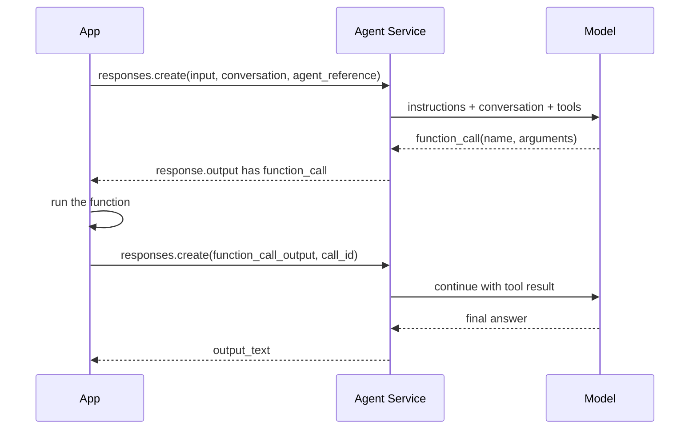

# Deep dive: building agents with Foundry Agent Service

An agent is a model plus instructions plus tools, wrapped so it can keep state and act. This page explains the moving parts, the function-calling loop step by step, and memory. Safety and identity are in [Agent safety and identity](agent-safety-and-identity.md); orchestration is in [Multi-agent workflows](../real-world/multi-agent-workflow-automation.md). Items marked `[NEEDS VERIFICATION]` are not confirmed on Microsoft Learn. Numbers marked *example* are illustrative.

---

## 1. Runtime components

| Component | Meaning | Analogy |
|---|---|---|
| **Agent** | A **versioned**, reusable definition: model, instructions, tools | A job description |
| **Conversation** | Persisted items: messages, tool calls, tool outputs | The case file |
| **Response** | One execution; continue with `previous_response_id` or a conversation | One step of work |



### Prompt agent or hosted agent?
| Choose | When |
|---|---|
| **Prompt agent** (server-side, defined by model + instructions + tools) | The behavior is expressible as instructions and tools; you want the simplest path |
| **Hosted agent** (your code, for example Agent Framework) | Custom orchestration, custom protocols, or logic that must run in your code |

Start with the simpler one; move up only when a requirement forces it.

---

## 2. Function calling, step by step

Learn's pattern has five steps. Here each is explained with what can go wrong.

1. **Define the function tool.** Give a name, a clear description and JSON-schema parameters, with `required` fields and `additionalProperties: False`. Set `strict=True` for stricter validation.
   *Why:* the description and schema are all the model knows about your function; vague text causes wrong calls.
   *Wrong:* two tools with overlapping descriptions; missing `required`.
2. **Create the agent** with the tool in its definition (`create_version`).
3. **Send a prompt.** The model may answer directly or emit a `function_call` item with `name`, `arguments` (a JSON string) and a `call_id`.
4. **Execute and return.** Your app parses the arguments, runs the function, and sends a `function_call_output` item carrying the **same `call_id`**.
   *Wrong:* forgetting to return the output (the agent returns a function call but no final answer); returning only some of several parallel calls.
5. **Get the final response.** The model uses your output to answer.

```python
import json
from azure.ai.projects import AIProjectClient
from azure.ai.projects.models import PromptAgentDefinition, FunctionTool
from azure.identity import DefaultAzureCredential
from openai.types.responses.response_input_param import FunctionCallOutput

project = AIProjectClient(endpoint=PROJECT_ENDPOINT, credential=DefaultAzureCredential())
openai = project.get_openai_client()
conversation = openai.conversations.create()

tool = FunctionTool(
    name="get_order_status",
    description="Get the status of one order for the signed-in customer.",
    parameters={"type": "object",
                "properties": {"order_id": {"type": "string", "description": "Order number, e.g. 4711"}},
                "required": ["order_id"], "additionalProperties": False},
    strict=True,
)
agent = project.agents.create_version(
    agent_name="support",
    definition=PromptAgentDefinition(model="gpt-4.1-mini",
                                     instructions="Help with order questions. Use tools for facts.",
                                     tools=[tool]),
)
ref = {"agent_reference": {"name": agent.name, "type": "agent_reference"}}

response = openai.responses.create(input="Where is order 4711?",
                                   conversation=conversation.id, extra_body=ref)
outputs = []
for item in response.output:
    if item.type == "function_call" and item.name == "get_order_status":
        result = lookup_order(**json.loads(item.arguments))      # your code, your authorization checks
        outputs.append(FunctionCallOutput(type="function_call_output",
                                          call_id=item.call_id, output=json.dumps(result)))
final = openai.responses.create(input=outputs, conversation=conversation.id, extra_body=ref)
print(final.output_text)
```

### Verify that it works (Learn's checks)
1. The first response has an output item of `type` `function_call`.
2. Your app executed the function with the returned arguments.
3. The follow-up response contains a `function_call_output` and the agent answers in natural language.
Use tracing to confirm the tool call happened.

### Rules and limits to remember
- **Runs expire 10 minutes after creation.** Submit outputs before that. For slow work, return a **status immediately** and poll separately; the 10 minutes applies to total elapsed time, not to one function.
- The **portal cannot add, edit or remove function definitions**; use the SDK or REST. Portal can run an agent that already has them, but does not execute your function.
- Treat arguments and outputs as **untrusted input**: validate before use.
- **No secrets** in tool output; return only what the model needs.
- **Least privilege** for the identity your code uses.
- Avoid side effects unless intended; require explicit confirmation for actions that change data. In the Agent Framework, `@tool(approval_mode=...)` controls approval; Learn's sample uses `never_require` for brevity and says to use `always_require` in production for human-in-the-loop.

### Troubleshooting (from Learn, condensed)
| Symptom | Cause | Fix |
|---|---|---|
| Function call but no final answer | Output not returned | Call `responses.create` again with the output and the conversation |
| No function call | Tool missing or poorly named | Confirm the tool is on the agent; improve names and descriptions |
| Arguments not valid JSON | Schema mismatch | Fix types and `required`; handle parse errors |
| Required fields missing | Schema does not enforce them | Add `required`; use `strict: true` |
| Outputs fail after a delay | Run expired | Return promptly; poll for slow work |
| Wrong parameters | Ambiguous description | Clarify descriptions with examples |
| Several calls in one response | Model needs several functions | Handle each; return all results in one call |

---

## 3. Other tools, briefly
Agents can also use built-in tools (retrieval, code, web) and remote **MCP** servers. For MCP, `allowed_tools` limits which tools are exposed, and `require_approval="always"` requires a person to approve each call. Treat tool descriptions and results from remote servers as untrusted. Details: [Agent safety and identity](agent-safety-and-identity.md).

### Who runs the tool? Server-side versus client-side

| Tool | Who executes it | What your app does |
|---|---|---|
| Function tool (your own function) | **Your app** | Run the function, send back `function_call_output` with the same `call_id` (see section 2) |
| File search, Azure AI Search, code interpreter, Bing grounding, MCP, OpenAPI | **The agent service** | Nothing; results come back inside the run |

A "hosted tool" is run by the service; a "function tool" is only a request that your code must fulfill.

### Agent as a tool (orchestrator and specialists)

The idea: an **orchestrator** agent hands sub-tasks to **specialist** agents and stays in control of the conversation. What Learn says today (page read 2026-10-26, [A2A tool](https://learn.microsoft.com/en-us/azure/foundry/agents/how-to/tools/agent-to-agent)):

- The **Connected Agents tool from the classic Agents API is not available in the new Foundry Agent Service.** Older exam material and practice tests may still call the pattern "connected agents" or `agent.as_tool`.
- The replacements are the **A2A tool** (a Foundry agent calls any A2A-compatible endpoint, including another Foundry agent exposed as an A2A endpoint) and **workflows** (declarative orchestration of several agents: sequential, group chat, human-in-the-loop). In **hosted agents** built with the Microsoft Agent Framework you can also expose one agent as a **function tool** of another, in-process.
- The `a2a` tool type (protocol 1.0) is **GA**; `a2a_preview` (protocol 0.3) stays in preview. Limits: text modality only, no streaming.

A2A call, step by step:

1. *Create a project connection* of category `RemoteA2A` whose target is the remote agent's base URI, with authentication (for a Foundry target: the A2A base path and audience `https://ai.azure.com`).
2. *Add an `A2ATool`* to the orchestrator agent, pointing to that connection. The orchestrator reads the remote agent card to know what it can do.
3. *Run the orchestrator.* When the question fits, it calls the remote agent; the remote agent returns a response.
4. *The orchestrator writes the final answer* and keeps managing the conversation. Check: the tool call appears in the trace/run output. Wrong: a missing connection or auth gives call failures.

How practice questions frame it: "orchestrator keeps control, each specialist call is auditable" points to agent-as-tool (A2A or workflow), not to the specialist talking to the user directly. Pick the option that matches the product the question names.

**Keep the tool set small:** each tool costs tokens, and more overlapping tools means more wrong selections.

---

## 4. Memory (preview)

Without memory an agent forgets everything between conversations. A **memory store** keeps durable knowledge extracted from conversations.

### What it does, step by step
1. **Extract:** after a conversation, the system pulls out items worth keeping.
2. **Consolidate:** an LLM merges duplicates and conflicting facts, so the store does not fill with repeats.
3. **Store:** items live in a managed store, partitioned by **scope**.
4. **Retrieve:** at run time the agent (through the memory search tool) or your code (store APIs) finds relevant items.

### Memory types and settings
| Option | Meaning |
|---|---|
| `user_profile_enabled` | Preferences and facts about the user (preferred name, dietary restriction, language). Retrieve once at the **start** of a conversation |
| `chat_summary_enabled` | Distilled summaries of topics or threads. Retrieve dynamically based on the current conversation |
| `procedural_memory_enabled` | Procedural memory, in the latest preview |
| `default_ttl_seconds` | Default time-to-live for new memory entries (retention control) |
| `user_profile_details` | Text telling the extractor what to avoid, e.g. "Avoid irrelevant or sensitive data, such as age, financials, precise location, and credentials" |

Creating a store needs a **chat model deployment** and an **embedding model deployment**; use one store per agent.

### Scope = isolation
The `scope` parameter partitions memory; each scope is an isolated collection. When you attach the memory search tool to an agent, set `scope` to `{{$userId}}`: the system resolves the end user's identity on each call, giving per-user isolation without hard-coding IDs. When calling memory APIs directly, pass the scope explicitly. Use a static scope only if you do not need per-user isolation.

*Worked example (example):* a travel agent. Scope = the customer. Turn 1: "I'm vegetarian and prefer window seats." The extractor stores two profile items. Next week the agent opens with profile retrieval and offers a vegetarian meal without being told. If the customer says "I eat fish now", consolidation updates the item instead of storing a contradiction.

### Limits and cost seen on Learn
Preview limits: 100 scopes per store, 10,000 memories per scope, 1,000 requests per minute each for search and for update. Memory is free during public preview. `[NEEDS VERIFICATION]` Limits and the number of memory types change in preview; recheck.

### Privacy and safety
Memory stores personal data. Set retention (TTL), tell the extractor what not to store, scope per user, support deletion requests, and do not let memory carry secrets. Memory content can contain injected text, so treat retrieved memories as untrusted context.

---

## 5. Putting it together: build order
1. One agent, one or two tools, no memory. Test with a golden set.
2. Add retrieval if answers need company data.
3. Add memory if repeated users need personalization.
4. Add approvals for risky tools.
5. Add tracing and evaluators (see [Observability](observability-and-agent-lifecycle.md)).
6. Only then consider multiple agents.

---

## Sources
- [Runtime components](https://learn.microsoft.com/en-us/azure/foundry/agents/concepts/runtime-components)
- [Function calling](https://learn.microsoft.com/en-us/azure/foundry/agents/how-to/tools/function-calling)
- [Create and use memory](https://learn.microsoft.com/en-us/azure/foundry/agents/how-to/memory-usage)
- [Memory concepts](https://learn.microsoft.com/en-us/azure/foundry/agents/concepts/what-is-memory)
