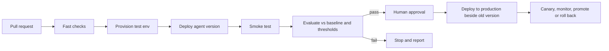

# Deep dive: CI/CD for Foundry projects

A normal app pipeline answers "does it build and pass tests?". An AI app also needs "is it still good, safe and affordable?", and the answer can change without any code change (a new model version, a different prompt). The pipeline therefore adds **evaluation** as a gate. The broader story is in [Shipping AI apps to production](../real-world/shipping-ai-apps-to-production.md).

The evaluation tooling below is **preview** on Learn. Pin versions and recheck the docs. Items marked `[NEEDS VERIFICATION]` are not confirmed on Microsoft Learn. Numbers marked *example* are illustrative.

---

## 1. The pipeline at a glance



### Walkthrough with a concrete change
A developer edits the support agent's instructions to be more concise.
1. **Pull request:** the change is reviewed like code because the agent definition and prompts are files in the repo.
2. **Fast checks:** lint, unit tests for tools, schema checks. Seconds, no model calls.
3. **Provision test environment:** infrastructure as code creates or updates a test Foundry project (`azd provision`).
4. **Deploy:** the new agent **version** is created (`azd deploy`). Versions are immutable (`name:version`), so the old version still exists.
5. **Smoke test:** one real prompt; the check looks at the **content** of the answer (for example it mentions the order status), not just that something was returned.
6. **Evaluate:** run the golden dataset through the new and the current production version; compare scores.
7. **Gate:** fail if any critical metric regresses, or any safety evaluator crosses its threshold.
8. **Approval and promotion:** a person reviews the evaluation report; production gets the new version beside the old; traffic shifts gradually; metrics decide promote or roll back.

---

## 2. Option A: Azure Developer CLI (`azd`) for hosted agents

What Learn describes:
- The template workflow runs on push to `main` and executes `azd provision` then `azd deploy`.
- Authentication uses **GitHub OIDC** (federated credentials), so no stored secret.
- A **concurrency group** serializes deployments so two runs never deploy at once.
- Evaluation (preview): create a suite once with `azd ai agent eval generate` (needs a deployed, invokable agent); run it in the pipeline with `azd ai agent eval run --no-prompt`. The command reads `eval.yaml` from the project root by default.
- Keep `eval.yaml` in source control and reuse the same file after each redeploy, so thresholds and dataset references stay comparable.
- The job should **fail the run** if scores fall below the thresholds.

*Illustrative skeleton (not copied from Learn; check the template for exact syntax):*

```yaml
name: deploy-agent
on:
  push:
    branches: [main]
concurrency:
  group: deploy-agent          # one deployment at a time
permissions:
  id-token: write              # GitHub OIDC to Azure
  contents: read
jobs:
  deploy:
    runs-on: ubuntu-latest     # use a self-hosted runner in the VNet for a private Foundry
    steps:
      - uses: actions/checkout@v4
      - uses: azure/login@v2   # federated credentials, no secret
        with:
          client-id: ${{ vars.AZURE_CLIENT_ID }}
          tenant-id: ${{ vars.AZURE_TENANT_ID }}
          subscription-id: ${{ vars.AZURE_SUBSCRIPTION_ID }}
      - run: azd provision --no-prompt
      - run: azd deploy --no-prompt
      - run: azd ai agent eval run --no-prompt   # fails the job below thresholds
```

## 3. Option B: the evaluation GitHub Action (preview)

- `microsoft/ai-agent-evals` (seen as `v3-beta` on Learn) runs **offline evaluation** of Foundry agents inside a workflow.
- Inputs include the project endpoint, a model deployment for the judge, a data file with queries and chosen evaluators, and agent IDs written as `agent-name:version`.
- List **several agents** to compare them; the baseline defaults to the first.
- Login uses `azure/login` with federated credentials.
- Output appears in the run summary, with **confidence intervals** and pairwise comparisons for several agents.
- Learn advises **not** running it on every commit, to control cost.

### Which option?
| Situation | Use |
|---|---|
| Deploying a hosted agent and want one tool chain | `azd` provision, deploy and eval |
| Comparing two agent versions with statistics in a GitHub workflow | The evaluation Action |
| Need to compare a candidate against the production version | Either; list both versions (`name:old`, `name:new`) |

---

## 4. Designing the evaluation gate

An absolute threshold ("score ≥ 4") hides regressions when the baseline is 4.8. Use both kinds of rule.

| Rule | Example |
|---|---|
| Absolute floor | Every safety evaluator defect rate ≤ 1% |
| Relative to baseline | Task adherence not lower than production by more than 0.1 |
| Must-pass cases | The 20 critical scenarios (refund limit, privacy request) must all pass |
| Budget | Median tokens per conversation ≤ production + 10% |

*Worked example (example numbers):* production task adherence = 4.6; candidate = 4.4 with a 95% interval of 4.3 to 4.5. The interval lies entirely below the baseline, so the gate fails even though 4.4 is above the floor of 4.0. Helpfulness rose, but a gate on "average improved" would have hidden the regression.

### Dataset hygiene
- Version the dataset with the code.
- Add every production incident as a new test case.
- Keep a small fast set (about a dozen cases) for every pull request and the full set for release candidates.

---

## 5. Environments, identity and network

- **Separate Foundry resources** for experiment, test and production; a dedicated resource per major production workload.
- Create projects and agents from **infrastructure as code**; portal-created projects do not inherit network controls.
- **OIDC federation** instead of stored secrets; least-privilege roles for the pipeline identity.
- A **private Foundry** blocks data-plane calls from public runners (403 or connection errors); run the pipeline on a **self-hosted runner inside the VNet**.
- After publishing an agent it gets a **distinct identity**; reassign roles as part of the release.

## 6. Rollout and rollback
- Agent versions are immutable, so rollback means pointing traffic back at the previous version.
- Foundry does not provide canary routing; build a routing layer (feature flag or gateway) to send 5% to the new version first.
- Pin model versions; a model change is a release, so it goes through the same gate.

---

## 7. What can go wrong, and how to check

| Problem | Cause | Check |
|---|---|---|
| Gate always passes | Dataset too easy or too small | Add failures from production; look at the confidence interval |
| Gate flaky | Judge variance, tiny sample | Run the evaluation twice; widen the dataset |
| Pipeline cannot reach Foundry | Private networking | Test from the runner; use a self-hosted runner |
| Deploy succeeded but users fail | Roles missing for the agent identity | Call a tool as the published agent |
| Cost spike from CI | Evaluation on every commit | Run the full evaluation on release candidates only |
| Preview step broke | Action or CLI version moved | Pin versions; read the changelog before upgrading |

---

## Sources
- [CI/CD for hosted agents with azd](https://learn.microsoft.com/en-us/azure/foundry/agents/how-to/set-up-ci-cd-cli)
- [Evaluation in GitHub Actions](https://learn.microsoft.com/en-us/azure/foundry/how-to/evaluation-github-action)
- [azd agent evaluation](https://learn.microsoft.com/en-us/azure/foundry/observability/how-to/azure-developer-cli-evaluation)
- [Hosted agent CI/CD quickstart](https://learn.microsoft.com/en-us/azure/foundry/agents/quickstarts/set-up-cicd-hosted-agent)
