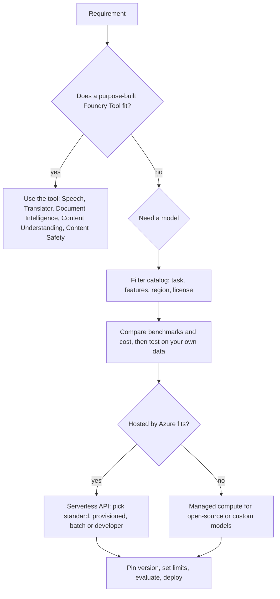

# Deep dive: choosing models, deployment types and services

Choosing a model is not one decision. It is five small decisions made in order: **which service**, **which model**, **which deployment option**, **which settings**, and **how you will keep it stable**. This page walks through each, with a worked example at the end.

Part of the [best practices overview](best-practices-and-real-world-scenarios.md). Capacity numbers are in [Capacity, cost, throttling](capacity-cost-and-throttling.md). Items marked `[NEEDS VERIFICATION]` are not confirmed on Microsoft Learn. Numbers marked *example* are illustrative.

---

## 1. Decision order at a glance

**Walkthrough.** A team must "read supplier PDFs and answer questions about them".
1. *Tool check:* reading the PDFs is extraction, so Content Understanding or Document Intelligence fits (see [CU and Document Intelligence](content-understanding-and-document-intelligence.md)). Answering questions needs a model.
2. *Catalog filter:* inference task = chat, feature = tool calling, region = the team's region.
3. *Compare:* shortlist two models; run 50 real questions through both.
4. *Deployment:* a hosted model sold by Azure, serverless. Managed compute is not needed.
5. *Stability:* pin the version and re-run the 50 questions before any upgrade.

---

## 2. The model catalog

The Foundry Models catalog lists more than 10,000 models, with about 50 new models per month.

| Category | Who hosts and supports | Billing | What you get |
|---|---|---|---|
| **Sold directly by Azure** | Microsoft hosts, sells and supports | Azure | Microsoft support and SLAs, Responsible AI review, fungible provisioned throughput for some models |
| **Partners and community** (Anthropic, Hugging Face, Mistral, Meta, Cohere and others) | The provider supports | Azure Marketplace | Wider choice; check the **License** tab and the provider's terms |

### How to search the catalog (step by step)
1. **Open the catalog** and apply filters. Available filters: collection, region, deployment option, deployment SKU, lifecycle (Preview, GA, Deprecated), industry, supported features (for example reasoning, tool calling) and inference task.
2. **Open a model card.** Tabs: *Details* (what it is), *Deployments* (how you can run it), *Benchmarks* (published scores) and *License*.
3. **Compare.** Use the leaderboard or **Compare models** to see quality, cost and throughput side by side.
4. **Test on your own prompts.** Benchmarks are averages; your data decides.

*What can go wrong:* choosing by leaderboard rank alone, ignoring the license, picking a Preview model for a production workload, or choosing a model not available in your region.

---

## 3. Deployment options

| Option | What it is | Key facts |
|---|---|---|
| **Serverless API** (preferred) | Models hosted for you, pay per use | Types: standard, provisioned, batch, developer. Scope: regional, data zone or global. Content filtering is built in and customizable. Entra ID and keys. Private networking. Can sit on a Foundry resource or an Azure OpenAI resource |
| **Managed compute** (preview) | Open-source, partner or custom models on dedicated GPUs | Billed per hour per accelerator SKU (for example A100, H100, MI300X). Global only. **No content filtering in preview.** Uses separate Foundry quota, not VM quota. Inference route `<endpoint>/managed-deployments/<name>/` |
| **Instant access** (preview) | Call a model by name with no deployment | Quick experiments |

Notes that Learn calls out:
- Content filtering is **not available for embedding and time-series models**.
- If you call a serverless model through an API that is not the Azure OpenAI SDK surface, you do **not** get filtering unless you add Azure AI Content Safety yourself.
- Older managed compute used a hub-based classic project.

### Choosing the deployment type (serverless)
| If your workload is... | Prefer | Why |
|---|---|---|
| Spiky or unknown traffic | Standard | Pay per token, no commitment |
| Steady, high volume, needs predictable latency | Provisioned | Reserved capacity (see [capacity](capacity-cost-and-throttling.md)) |
| Large offline job (reports, back-fills) | Batch | Asynchronous, cheaper per token, not interactive |
| Data must stay in a region or data zone | Regional or data zone | Residency; global may process elsewhere |
| Lowest cost per token and residency is not a concern | Global | Widest capacity pool |

`[NEEDS VERIFICATION]` The exact discount for batch and the exact meaning of the *developer* type were not read in this session; confirm on the deployment types page.

---

## 4. Reasoning models: what changes

A reasoning model produces hidden "thinking" tokens before the visible answer.

### Step by step: what happens in one call
1. You send input (and optionally `reasoning_effort`).
2. The model generates **reasoning tokens**. You do not see them. They are **billed as output tokens** and share the context window.
3. The model generates the visible answer.
4. The response reports `reasoning_tokens` in `completion_tokens_details` (Chat Completions) or `output_tokens_details` (Responses).
5. If the total output hits your cap before the answer is finished, the response is **incomplete** and the visible text can be empty or cut.

*Worked example (example numbers):* input 1,000 tokens; reasoning 6,000; visible answer 500. Billed output = 6,500. If `max_output_tokens` is 4,000, reasoning alone consumes the budget: status `incomplete`, no answer. Fix: raise the cap. Learn recommends **reserving at least 25,000 tokens** for reasoning plus output at first, then tuning down from measurements.

### Settings that matter
| Setting | Guidance |
|---|---|
| `max_output_tokens` (Responses) / `max_completion_tokens` (Chat) | Caps reasoning plus answer together |
| `reasoning_effort` | Values vary by model (none, minimal, low, medium, high, xhigh, max). Use `none` for latency-critical tasks such as voice or simple classification |
| Developer message | Plays the role of the system message for these models |
| Reasoning summary | `reasoning.summary` through the **Responses API** only |
| Function tools with effort | Some model and API combinations are not supported (for example one model in Chat Completions); use Responses or effort `none` |

Do **not** try to pull raw reasoning out with prompt tricks: Learn says it is unsupported, may violate the Acceptable Use Policy and can lead to throttling. Classic techniques such as "think step by step" are not recommended for reasoning models.

*How to check:* log `reasoning_tokens` per request for a day; the 95th percentile tells you the cap to set.

---

## 5. Foundry Tools or Foundry models?

| Need | Choose | Why |
|---|---|---|
| OCR, layout, prebuilt forms, field extraction from files | Document Intelligence / Content Understanding | Purpose-built, structured output, confidence scores |
| Translate text or whole documents | Translator | Scale, glossaries, format preservation |
| Transcribe or synthesize speech | Speech | Specialized models, diarization, custom voice |
| Detect harmful content | Content Safety / guardrails | Dedicated classifiers |
| Reason, draft, plan, call tools | Foundry model | General capability |
| Sentiment, summary, intent for a **new** project | Foundry model | Those Language features retire March 31, 2029 (see [Text analysis](text-analysis-language-and-llms.md)) |

Rule: use the **narrowest** service that meets the requirement; add a model where context and judgment are needed; combine them when each does what it is best at.

*Embedding note:* the project endpoint used by the Foundry SDK does not currently route embedding requests; use the OpenAI-compatible `/openai/v1` endpoint for embeddings (see [Foundry SDK](foundry-sdk-and-generative-apps.md)).

---

## 6. Improving quality: the ladder

Climb one rung at a time and measure after each.
1. **Prompt** clearly (see [Prompt engineering](prompt-engineering-parameters-and-reflection.md)).
2. **Ground** with retrieval (see [Retrieval and grounding](rag-retrieval-and-grounding.md)).
3. **Choose a better or larger model** if rungs 1 to 2 are not enough.
4. **Fine-tune** when you need a consistent style or format that prompting cannot hold, and have good examples.

Fine-tuning costs training and hosting and must be re-done when the base model changes, so it is the last rung, not the first.

---

## 7. Lifecycle and stability

Models move through **Preview → GA → Deprecated → Retired**. When a model retires, deployments stop working (for example `dall-e-3` retired on March 4, 2026).

### Safe upgrade procedure (step by step)
1. **Subscribe** to deprecation notices and note retirement dates.
2. **Pin** the model version in production (no auto-upgrade) so behavior does not change silently.
3. **Deploy** the new version beside the old one.
4. **Evaluate** both on the same golden dataset: quality, safety, latency, cost.
5. **Switch** traffic through configuration, keep the old deployment until stable.
6. **Record** the version in your release notes and traces.

*What can go wrong:* auto-upgrade changes tone or format and breaks a JSON parser; a retired model with no replacement plan; different token behavior changes cost.

---

## Sources
- [Foundry Models overview](https://learn.microsoft.com/en-us/azure/foundry/concepts/foundry-models-overview)
- [Reasoning models](https://learn.microsoft.com/en-us/azure/foundry/openai/how-to/reasoning)
- [Foundry SDKs and endpoints](https://learn.microsoft.com/en-us/azure/foundry/how-to/develop/sdk-overview)
